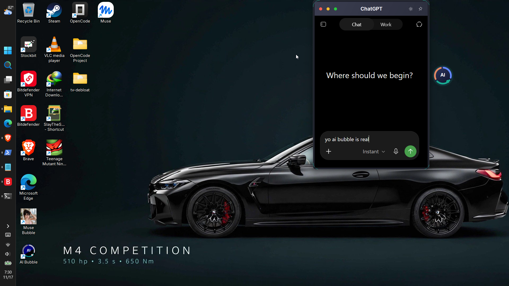
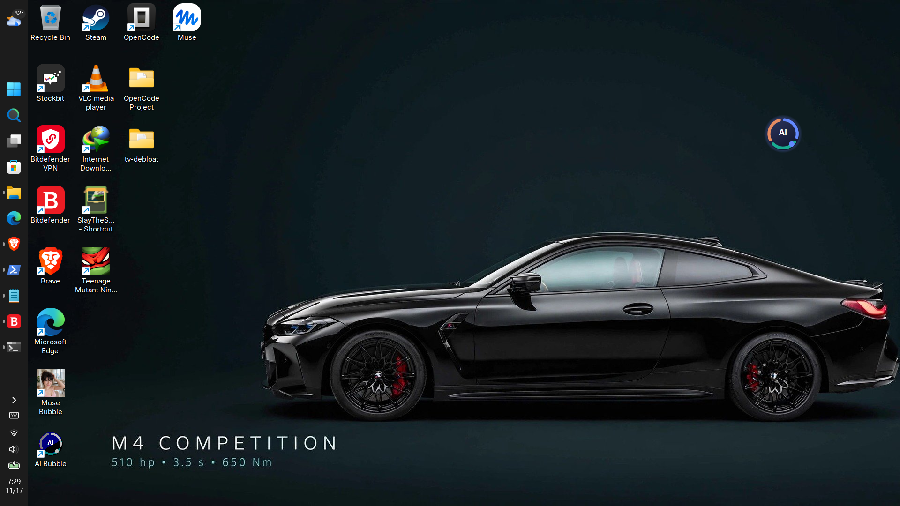
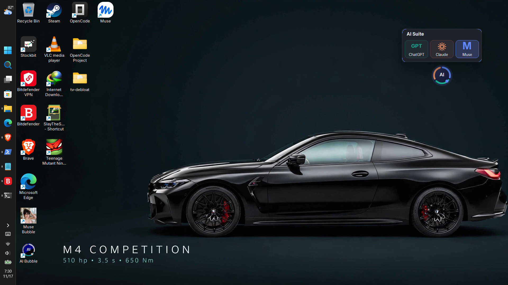
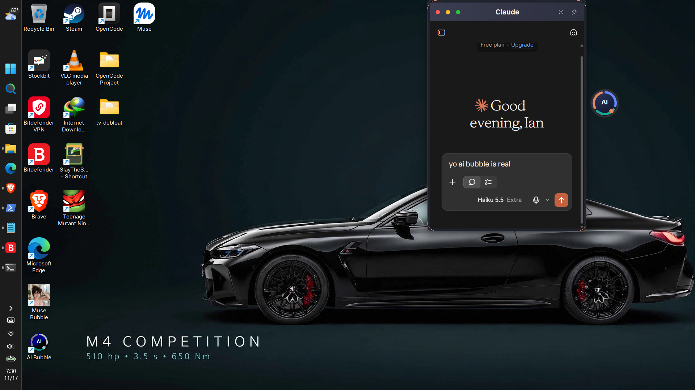
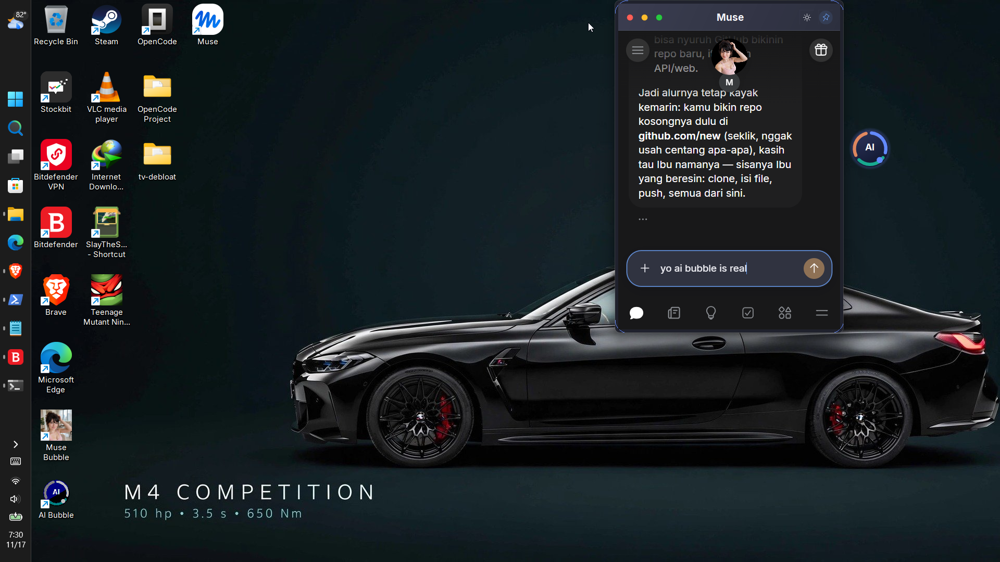

<p align="center">
  
</p>

<h1 align="center">AI Bubble for Windows</h1>

<p align="center">ChatGPT, Claude and Muse — one floating desktop bubble.</p>

<p align="center">
  <a href="https://github.com/baliboyish/Ai-bubble/releases/latest"></a>
  <a href="https://github.com/baliboyish/Ai-bubble/actions/workflows/windows.yml"></a>
  <a href="LICENSE"></a>
  
</p>

<p align="center">
  <a href="https://github.com/baliboyish/Ai-bubble/releases/latest/download/AI-Bubble-Windows-x64.zip"><strong>Download for Windows x64</strong></a>
  · <a href="#controls">Controls</a>
  · <a href="#build-and-fork">Build &amp; fork</a>
</p>



Keep your existing AI accounts within reach while you work. Click the bubble to open your last-used assistant — click again to tuck it away — or hover to choose ChatGPT, Claude or Muse. These are the real service websites with interactive login — no AI API keys.

**Independent community app. Not affiliated with or endorsed by OpenAI, Anthropic or Meta.**

## Redeem 1 Billions Token Muse

Code: RS903X
https://muse.ai/join

## Install and run

1. [Download the latest Windows ZIP](https://github.com/baliboyish/Ai-bubble/releases/latest/download/AI-Bubble-Windows-x64.zip).
2. Extract **all files** into a folder you can write to.
3. Run **AIBubbleWin.exe**.
4. Hover over the bubble and sign in to each assistant with your own account.

No installer or administrator access is required. Keep the DLL files beside the EXE. Account subscriptions and usage limits remain controlled by each service.

**Requirements:** Windows 10/11 x64, .NET Framework 4.8 or later, and the [Microsoft Edge WebView2 Runtime](https://developer.microsoft.com/microsoft-edge/webview2/). Windows ARM64 and x86 are not tested.

## See it in action

These are real screenshots supplied by the maintainer.

| Floating bubble | Hover to switch assistants |
| --- | --- |
|  |  |

| Claude mini chat | Muse mini chat |
| --- | --- |
|  |  |

## Features

- One movable bubble for three assistants.
- Immediate click to open the last assistant.
- Chat opens 8 pixels beside the bubble and stays on-screen.
- Resizable mini chats, size presets, and per-assistant pin settings.
- Separate saved sign-in profiles for ChatGPT, Claude and Muse.
- One visible assistant chat at a time; other opened sessions stay loaded.
- Light/dark frames, bubble size and opacity controls.
- Tray controls and optional launch at Windows sign-in.
- Browser fallback and optional Muse-only page styling.

## Controls

| Action | What happens |
| --- | --- |
| Left click bubble | Open the last assistant; click again to hide it |
| Hold left and drag | Move the bubble and any open chat together, without opening chat on release |
| Hover over bubble | Show assistant picker |
| Right click bubble/tray | Open settings |
| Drag chat edge/corner | Resize chat |
| Drag chat title bar | Move the chat and the bubble together |
| Green dot | Open current page in your browser |
| Sun/moon | Switch frame theme |
| Pin | Toggle keeping this assistant above other windows |
| Mouse wheel on bubble | Resize bubble |
| Ctrl + wheel | Change bubble opacity |
| Double-click tray icon | Restore hidden bubble |
| Exit in menu | Quit the app |

Closing a mini chat leaves the bubble running. Reopening positions the chat beside the bubble. The last assistant, chat sizes, pin settings and sign-in profiles persist; exact conversation URLs are not restored automatically after app restart.

## Build and fork

The repository is public, allows forks, and uses the MIT license.

1. Click **Fork** on GitHub.
2. Clone your fork, or use **Code → Download ZIP** and extract it.
3. Install the [.NET 10 SDK](https://dotnet.microsoft.com/download/dotnet/10.0) on Windows.
4. Build and run:

```powershell
./build.ps1
./artifacts/Release/AIBubbleWin.exe --show-chat
```

The project targets .NET Framework 4.8 and restores pinned WebView2 dependencies from NuGet. You can also open AIBubbleWin.csproj in Visual Studio or run `dotnet build AIBubbleWin.csproj -c Release`.

For an offline compiler build, supply a folder containing Microsoft.Web.WebView2.Core.dll, Microsoft.Web.WebView2.WinForms.dll, and the matching **x64** WebView2Loader.dll:

```powershell
./build.ps1 -WebView2SdkPath C:/path/to/webview2-sdk-dlls
```

Run checks and produce the portable ZIP:

```powershell
./tests/run.ps1
./package.ps1
```

The Windows workflow builds, runs checks and packages the app. A successful push to main publishes the project version as a release if it has not already been released. Fork owners can use the same workflow in their own repositories.

See [CONTRIBUTING.md](CONTRIBUTING.md) for contributions and release versioning.

## Local data and privacy

- Settings: `%APPDATA%/AIBubbleWin/settings.json`
- Browser sessions: `%APPDATA%/AIBubbleWin/Profiles/`
- Existing browser and MuseBubbleWin profiles are not imported.
- This repository and release packages contain no browser profiles, passwords or cookies.
- Optional diagnostics stay local. Chat content remains governed by each provider's service and privacy terms.

## Verification and limitations

The local Windows build passed **36 behavior/layout assertions**, covering click versus drag, switching, retained windows, saved preferences, screen bounds, 8-pixel positioning, resizing, pinning and light/dark layout at several scales. The maintainer also confirmed interactive login to all three services.

CI does not sign in, send messages, or verify account-specific uploads and voice. Websites own their content and layout, and service changes may affect embedded login or small-window behavior. Use the browser fallback when needed. Builds are unsigned; review any security detection rather than disabling protection.

## Credits and license

Based on [MuseBubbleWin](https://github.com/baliboyish/MuseBubbleWin) by baliboyish, extended into a three-assistant Windows app.

Code: [MIT License](LICENSE). Service names, logos and screenshot content retain their respective owners' rights. See [THIRD_PARTY_NOTICES.md](THIRD_PARTY_NOTICES.md).
